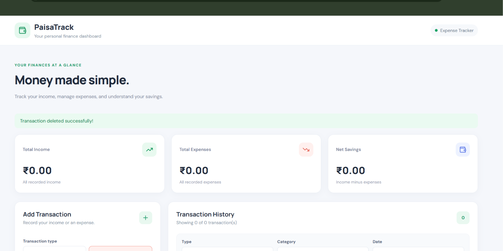
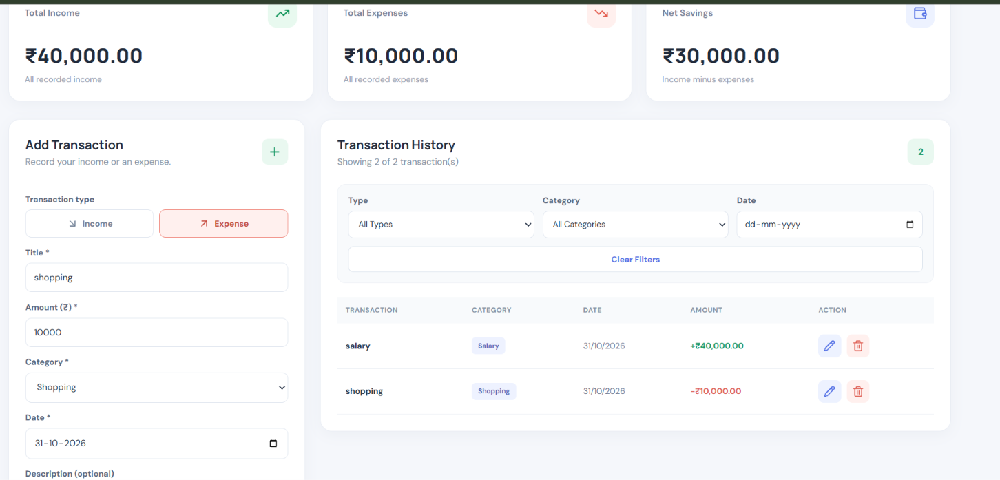
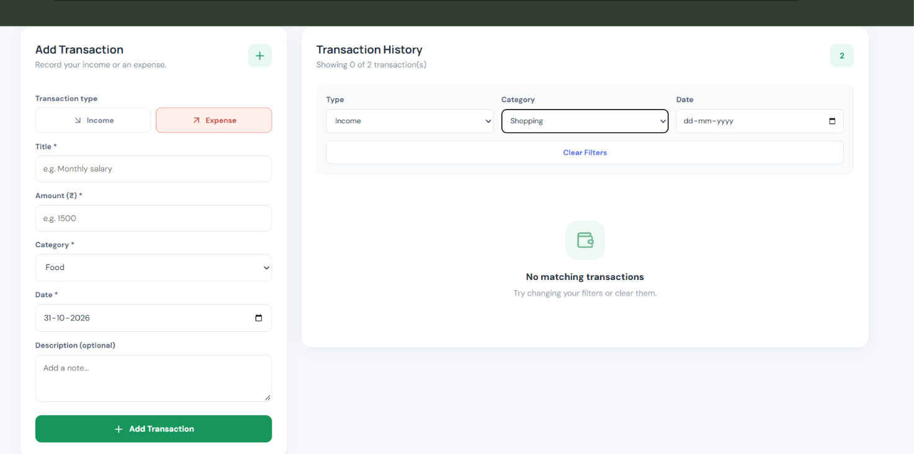
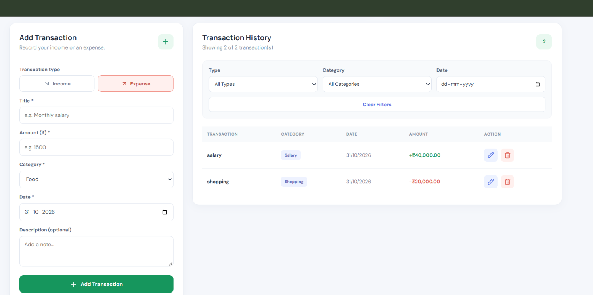
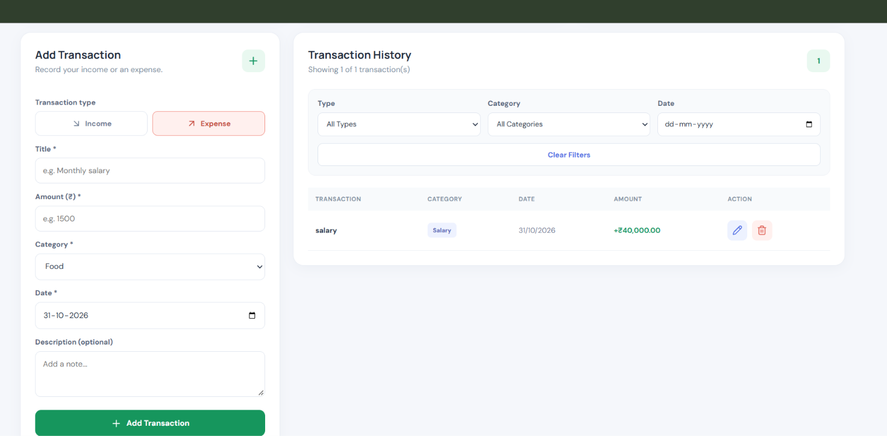

# PaisaTrack — Expense Tracker

PaisaTrack is a full-stack MERN Expense Tracker application that helps users record income and expenses, monitor savings, and manage transactions through a simple and responsive dashboard.

## Live Demo

**Live Application:** https://paisa-track-owipohryu-sayantikadas06.vercel.app

**GitHub Repository:** https://github.com/sayantikadas06/PaisaTrack

## Features

- Add, edit, and delete transactions.
- Track income and expenses by category.
- View total income, total expenses, and net savings.
- Filter transactions by type, category, and date.
- Clear filters to view all transactions.
- Client-side and server-side input validation.
- Store transaction data persistently in MongoDB.
- Responsive interface for desktop and mobile devices.

## Technologies Used

### Frontend
- React
- Vite
- Axios
- Lucide React
- CSS

### Backend
- Node.js
- Express.js
- MongoDB
- Mongoose
- dotenv
- CORS

## Project Structure

```text
expense tracker_application/
├── vite-project/
│   ├── src/
│   ├── package.json
│   └── ...
├── Backend/
│   ├── controllers/
│   ├── models/
│   ├── routes/
│   ├── server.js
│   ├── package.json
│   └── .env
├── .gitignore
└── README.md
```

## Getting Started

### Prerequisites

- Node.js and npm
- MongoDB Atlas account or a MongoDB server
- Visual Studio Code (recommended)

### 1. Clone the Repository

```bash
git clone https://github.com/sayantikadas06/PaisaTrack.git
cd PaisaTrack
```

### 2. Configure the Backend

```bash
cd Backend
npm install
```

Create a `.env` file inside the `Backend` folder:

```env
MONGO_URI=your_mongodb_connection_string
PORT=5000
CLIENT_URL=http://localhost:5173
```

Replace the MongoDB placeholder with your own connection string. Never commit real database credentials to GitHub.

Start the backend:

```bash
npm run dev
```

The backend runs at `http://localhost:5000`.

### 3. Configure the Frontend

Open a second terminal from the project root:

```bash
cd vite-project
npm install
```

Create a `.env` file inside `vite-project`:

```env
VITE_API_URL=http://localhost:5000/api/transactions
```

Start the frontend:

```bash
npm run dev
```

Open the local URL displayed by Vite, usually `http://localhost:5173`.

Keep both terminals running while using the application.

## REST API Endpoints

**Base URL:** `http://localhost:5000/api/transactions`

| Method | Endpoint | Description |
|---|---|---|
| GET | `/` | Retrieve all transactions |
| POST | `/` | Create a transaction |
| GET | `/summary` | Retrieve income, expense, and net savings totals |
| PUT | `/:id` | Update a transaction |
| DELETE | `/:id` | Delete a transaction |

### Transaction Data Model

Each transaction contains:

| Field | Type | Description |
|---|---|---|
| `title` | String | Transaction title |
| `amount` | Number | Transaction amount; must be greater than zero |
| `type` | String | `income` or `expense` |
| `category` | String | Transaction category |
| `date` | Date | Transaction date |
| `description` | String | Optional description |
| `createdAt` | Date | Automatically generated creation timestamp |
| `updatedAt` | Date | Automatically generated update timestamp |

The backend uses Mongoose for database schema validation and server-side validation. The frontend also validates user input before submitting transactions.

## Summary Calculations

- **Total Income:** Sum of all income transactions.
- **Total Expenses:** Sum of all expense transactions.
- **Net Savings:** Total income minus total expenses.

Summary values are calculated by the backend using MongoDB transaction records.

## Data Persistence

All transaction records are stored in MongoDB. Saved records remain available after restarting the backend, provided the database remains accessible.

## Screenshots

### Dashboard


### Transaction History


### filters


### Edit Transaction


### Delete Transaction



## Deployment

- **Frontend:** Vercel
- **Backend:** Render
- **Database:** MongoDB Atlas

## Author

Developed as a full-stack development internship project for CodeNova.